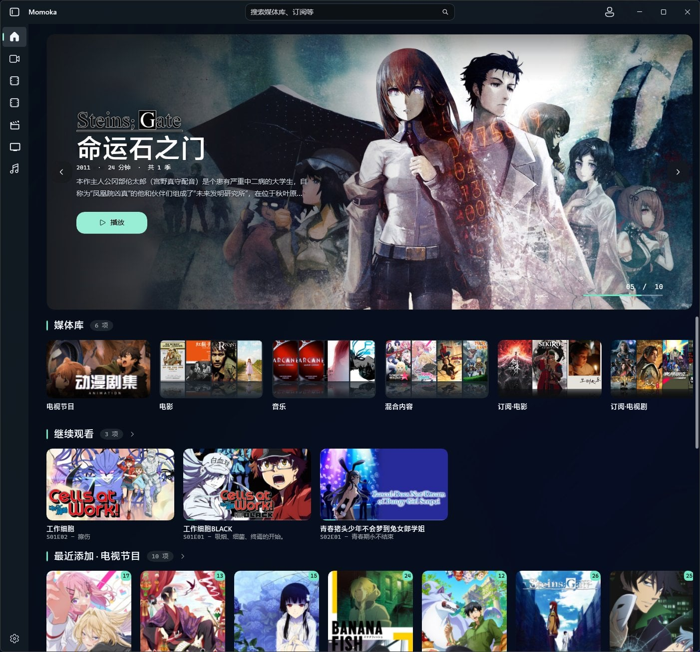
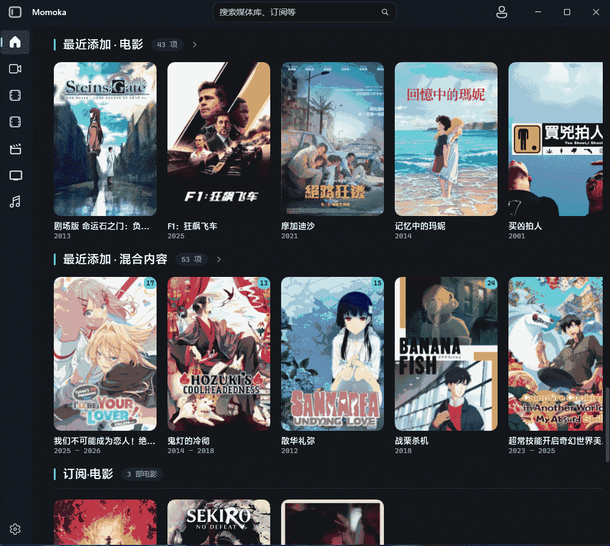

# Momoka

**Windows 端播放、订阅、下载、刮削与文件管理一体化媒体客户端**

[English](README_EN.md) · [微软商店](https://apps.microsoft.com/detail/9nqjl7k0h8x0?hl=zh-CN&gl=CN) · [GitHub Releases](https://github.com/cudamin/Momoka/releases) · [问题反馈](https://github.com/cudamin/Momoka/issues) · [Telegram](https://t.me/Ebizuka_Tomo) · [QQ群](https://qm.qq.com/q/vXph3vMyFW)

## 界面预览

<em>媒体库、继续观看、最近添加与订阅内容集中在同一个首页。</em>

## 功能

- **媒体库播放**：连接 Emby、Jellyfin、飞牛影视；Plex 支持仍属实验性，尚未用真实服务器验证。内置 libmpv 可在主窗口集成播放或独占窗口播放，也可调用本机 mpv。
- **资源订阅与整理**：连接 MoviePilot 搜索资源、管理订阅、确认下载，并查看整理任务与历史。AniBT 可按番剧检索和核对资源，再交由 MoviePilot 下载或整理。
- **媒体文件管理**：按服务器支持情况浏览媒体库、编辑元数据、换封面、管理字幕、标记观看状态，以及执行合集、播放列表等操作。
- **本机目录整理**：把本地磁盘或网络共享目录建成本机媒体库，用 TMDB 或 MoviePilot 识别，并按改名、硬链接或软链接整理；可选监控目录并自动刮削入库。本机媒体库目前用于浏览已入库内容，不在 Momoka 内播放。
- **音乐库**：Emby、Jellyfin 与飞牛音乐共用音乐界面和播放栏；Plex 目前只有协议适配，未验证真实服务器音乐播放。
- **可选播放增强**：着色器、SVP 补帧接入、弹幕、字幕筛选与实时字幕翻译。SVP 和实时翻译默认关闭；翻译需自备服务密钥，启用后会把文字字幕发送给所选服务。
- **播放工具**：可配置本机 FFmpeg/FFprobe、字幕同步与语音识别工具，用于导出片段、GIF、字幕、截图及章节文件。

## 下载与运行

- **Microsoft Store**：[安装 Momoka](https://apps.microsoft.com/detail/9nqjl7k0h8x0?hl=zh-CN&gl=CN)
- **GitHub**：[查看 Releases](https://github.com/cudamin/Momoka/releases)。请留意发布页面标注的预发布状态。

系统要求：Windows 10 版本 1809 或更高版本，x64。Emby、Jellyfin 或飞牛影视需要各自可访问的媒体服务器；资源订阅、下载和整理需要自行部署并配置 MoviePilot。

已核对的版本与能力边界：Jellyfin 10.10.7 已验证保存登录恢复、媒体库读取、原画播放和续播；飞牛影视网页 0.9.8 / 服务 0.8.43 已验证相同范围。相关管理写入和其它覆盖边界见 [Jellyfin 支持说明](docs/Jellyfin支持.md) 与 [飞牛影视说明](docs/飞牛影视.md)。Plex 仅有协议与离线测试适配，真实服务器连接、浏览和播放尚未验证，详见 [Plex 支持说明](docs/Plex支持.md)。这些版本记录不是对所有版本的兼容保证。

## 开发与验证

Momoka 使用 WinUI 3、.NET 10 与 libmpv。开发环境和提交前检查见 [贡献指南](CONTRIBUTING.md)；整体架构和验证范围见[技术文档](docs/技术文档.md)与[开发和验证说明](docs/开发与验证.md)。

## 隐私与许可

Momoka 不含遥测、广告或使用统计。启用的媒体服务器、弹幕和字幕翻译功能会向相应服务发送完成该功能所需的信息，详见[隐私政策](PRIVACY.md)。

Momoka 自身代码按 [GPL-3.0-or-later](LICENSE) 授权，并附有限的微软组件链接许可。随包第三方组件保留各自许可，详见[第三方组件声明](THIRD-PARTY-NOTICES.md)。
