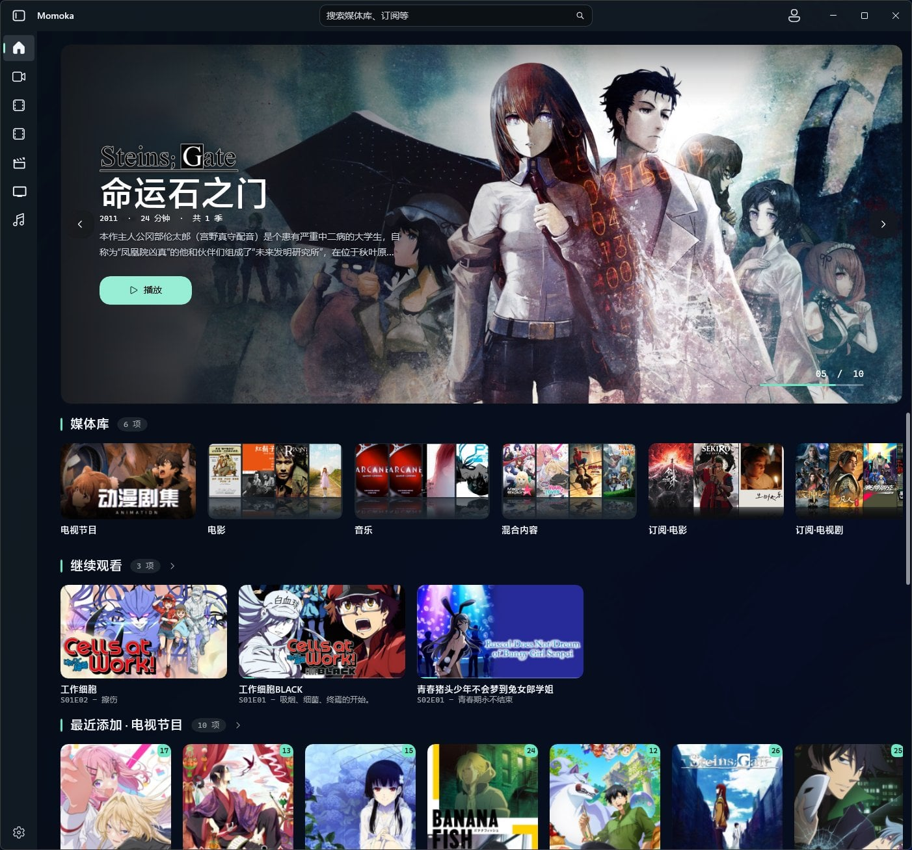
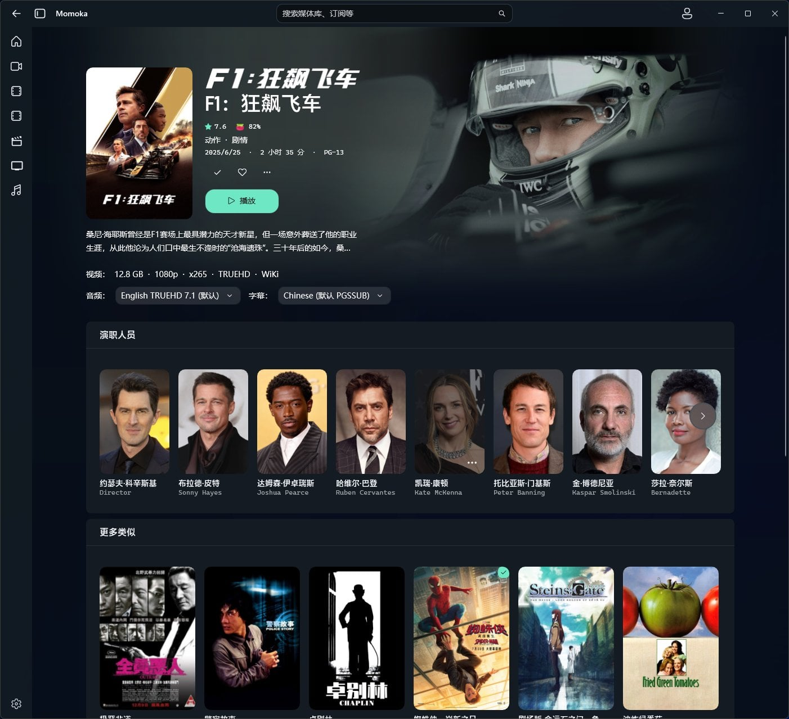
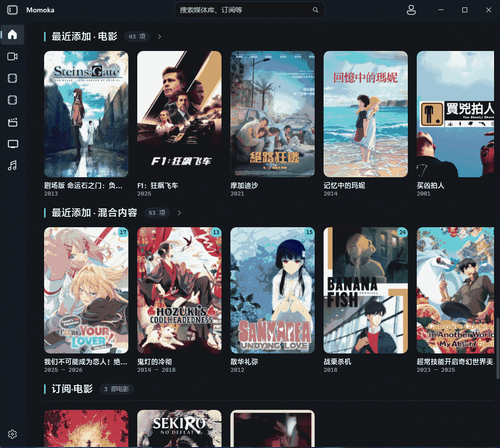

# Momoka

**An all-in-one Windows media client for playback, subscriptions, downloads, metadata scraping, and file management.**

[简体中文](README.md) · [Microsoft Store](https://apps.microsoft.com/detail/9nqjl7k0h8x0?hl=en-US&gl=US) · [GitHub Releases](https://github.com/cudamin/Momoka/releases) · [Issues and feedback](https://github.com/cudamin/Momoka/issues)

## Who It Is For and Getting Started

Momoka is for Windows users who already have an Emby, Jellyfin, or fnOS Media server and want to browse and play it from one desktop app. Subscriptions, downloads, and organization also require a separately hosted and configured MoviePilot instance.

1. Make sure your PC runs Windows 10 version 1809 or later (x64) and can reach your media server.
2. Install from the [Microsoft Store](https://apps.microsoft.com/detail/9nqjl7k0h8x0?hl=en-US&gl=US), or download from [GitHub Releases](https://github.com/cudamin/Momoka/releases). The latest GitHub Release is currently marked Pre-release. The installer and portable ZIP are unsigned, so Windows SmartScreen may show a warning on first launch. Review the release notes before downloading.
3. Start Momoka, open **Settings → Servers**, add your server address, and sign in. Then select the libraries you want to browse.

## Screenshots

<table width="100%">
  <tr>
    <td width="50%" align="center" valign="top"> <em>Libraries, continue watching, and recent additions</em></td>
    <td width="50%" align="center" valign="top"> <em>Movie details and media information</em></td>
  </tr>
</table>

## Features

- **Media server playback:** Connect to Emby, Jellyfin, and fnOS Media. Plex support is experimental and has not been verified against a live server. The built-in libmpv player runs embedded in the main window or in a dedicated window; Momoka can also launch a local mpv executable.
- **Subscriptions and media organization:** Connect to MoviePilot to search for resources, manage subscriptions, confirm downloads, and review organization jobs and history. AniBT helps find and check anime releases, then hands download or organization tasks to MoviePilot.
- **Library management:** Browse server libraries and, where supported by the server, edit metadata, change artwork, manage subtitles, update watched status, and work with collections or playlists.
- **Local folder organization:** Create a local library from a disk or network share, identify media with TMDB or MoviePilot, and organize it by renaming or using hard or symbolic links. Optional folder monitoring can scrape and import new items. Local libraries currently let you browse imported items; Momoka does not play them directly.
- **Music:** Emby, Jellyfin, and fnOS Music share a music interface and playback bar. Plex currently has protocol adaptation only; live-server music playback has not been verified.
- **Optional playback features:** Shaders, SVP frame interpolation integration, danmaku, subtitle selection, and real-time subtitle translation. SVP and translation are off by default. Translation requires your own service credentials and sends subtitle text to the selected provider when enabled.
- **Media tools:** Configure local FFmpeg/FFprobe, subtitle synchronization, and speech recognition tools to export clips, GIFs, subtitles, screenshots, and chapter files.

## Download and requirements

- **Microsoft Store:** [Install Momoka](https://apps.microsoft.com/detail/9nqjl7k0h8x0?hl=en-US&gl=US)
- **GitHub:** [Browse Releases](https://github.com/cudamin/Momoka/releases). Check each release page for its preview status.

Requires Windows 10 version 1809 or later, x64. Emby, Jellyfin, or fnOS features require access to the corresponding media server. Resource subscriptions, downloads, and organization require a separately hosted and configured MoviePilot instance.

Verified compatibility notes: Jellyfin 10.10.7 has been checked for saved-login restoration, library reads, original-quality playback, and resume. The same scope has been checked with fnOS Media Web 0.9.8 / Service 0.8.43. Management writes have not been verified for Jellyfin or fnOS Media. Other coverage boundaries are documented in the [Jellyfin notes](docs/Jellyfin支持.md) and [fnOS notes](docs/飞牛影视.md). Plex has offline protocol adaptation only; live connection, browsing, and playback have not been verified. See the [Plex notes](docs/Plex支持.md). These version records are not guarantees of compatibility with every release.

## Development and verification

Momoka is built with WinUI 3, .NET 10, and libmpv. Start with the [project rules](CLAUDE.md), then use the [contribution guide](CONTRIBUTING.md), [architecture notes and document map](docs/技术文档.md), and [development and verification guide](docs/开发与验证.md).

## Privacy and license

Momoka does not include telemetry, advertising, or usage analytics. Optional media-server, danmaku, and subtitle-translation features send the information needed to provide those features. See the [privacy policy](PRIVACY.md).

Momoka's own code is licensed under [GPL-3.0-or-later](LICENSE), with a limited linking permission for specified Microsoft components. Bundled third-party components retain their own licenses; see [Third-Party Notices](THIRD-PARTY-NOTICES.md).
